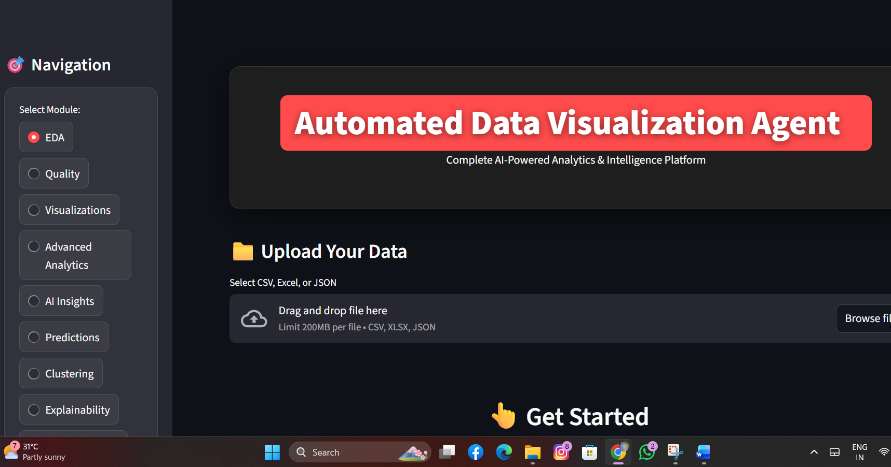
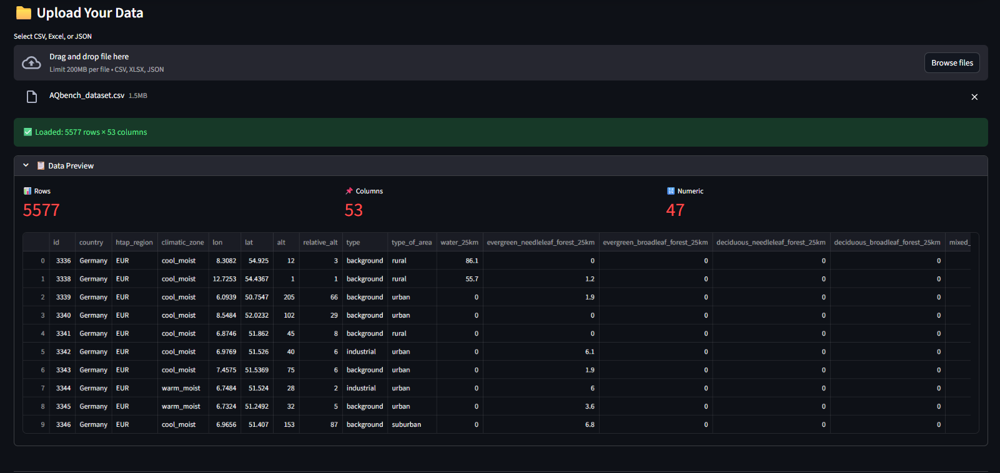
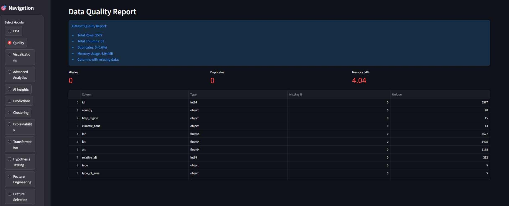
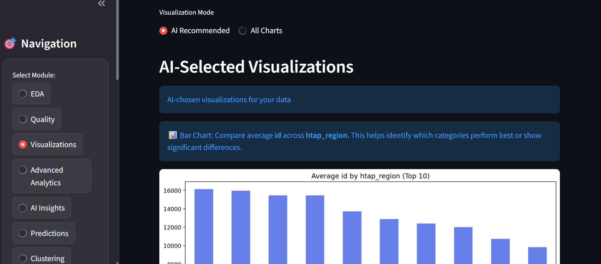
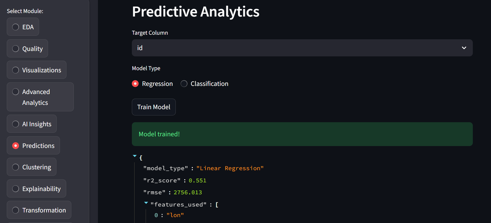
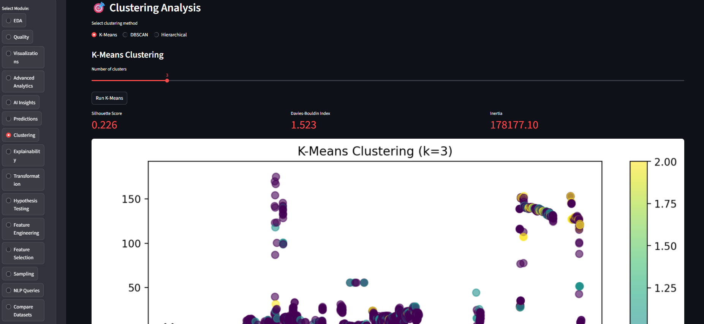
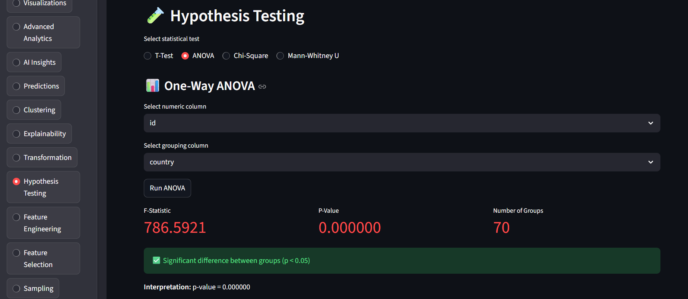
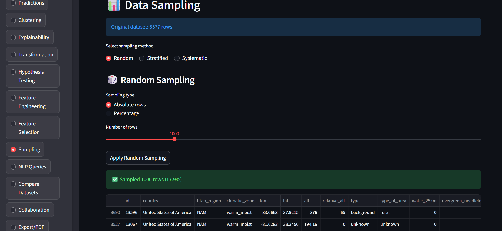
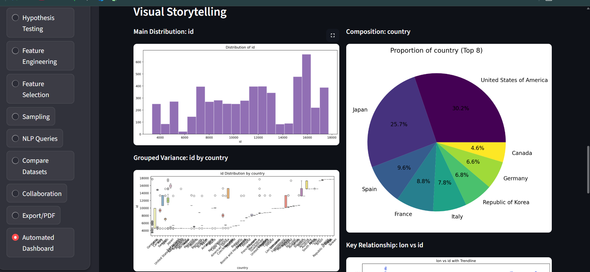
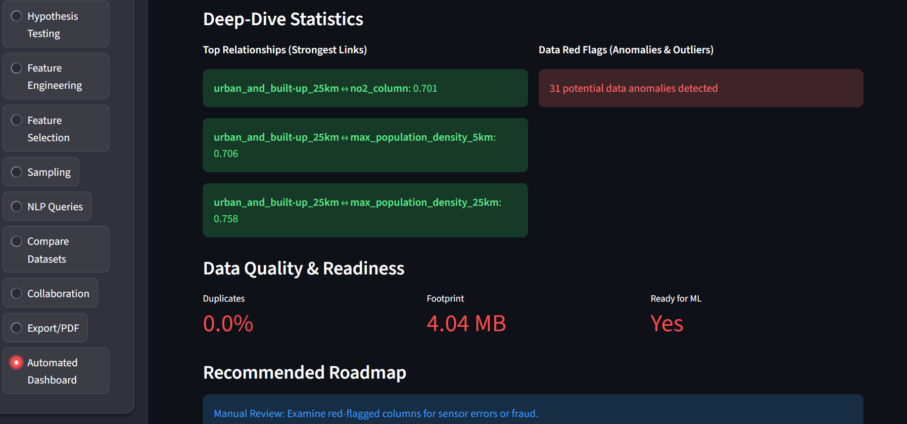

# 🚀 Automated Data Visualization Agent

### AI-Powered Analytics & Intelligence Platform

An intelligent, interactive data analytics platform developed using Python and Streamlit. The application automates Exploratory Data Analysis (EDA), data quality assessment, AI-powered visualization recommendations, statistical analysis, machine learning, and predictive analytics.

Transform raw datasets into meaningful insights, interactive visualizations, and actionable intelligence through a single platform.

---

## 📸 Application Screenshots

The following screenshots demonstrate the actual working application and its analytical outputs.

### 1. Application Home Page



### 2. Dataset Upload and Preview



### 3. Data Quality Report



### 4. AI-Powered Visualizations



### 5. Predictive Analytics



### 6. Clustering Analysis



### 7. Statistical Hypothesis Testing



### 8. Data Sampling



### 9. Automated Visual Storytelling



### 10. Automated Dashboard and Deep-Dive Insights



---

## ✨ Key Features

### 📂 1. Data Upload and Exploration
- Supports CSV, Excel, and JSON datasets.
- Interactive dataset preview.
- Automatic row and column detection.
- Numeric and categorical column identification.

### 📊 2. Exploratory Data Analysis (EDA)
- Automated exploratory data analysis.
- Statistical summaries.
- Distribution analysis.
- Correlation analysis.
- Outlier detection.
- Automated visual storytelling.

### 🧹 3. Data Quality Analysis
- Missing value detection.
- Duplicate record identification.
- Data type inspection.
- Unique value analysis.
- Dataset memory usage.
- Data quality reporting.

### 🤖 4. AI-Powered Visualization
- Intelligent chart recommendations.
- Automatic visualization selection.
- Bar charts, scatter plots, box plots, histograms, and heatmaps.
- AI-generated visualization explanations.

### 📈 5. Predictive Analytics
- Regression analysis.
- Classification workflows.
- Machine learning model training.
- Model performance evaluation.
- Prediction results.

### 🎯 6. Clustering Analysis
- K-Means clustering.
- DBSCAN clustering.
- Hierarchical clustering.
- Silhouette score.
- Davies-Bouldin index.
- Cluster visualization.

### 🧪 7. Statistical Hypothesis Testing
- T-Test.
- One-Way ANOVA.
- Chi-Square Test.
- Mann-Whitney U Test.
- Statistical significance interpretation.

### 🧠 8. Advanced Analytics
- Feature engineering.
- Feature selection.
- Model explainability.
- Time-series analysis.
- Correlation analysis.
- Data transformation.
- Outlier analysis.

### 📉 9. Automated Dashboard
- Automated visual summaries.
- Key statistical relationships.
- Anomaly identification.
- Dataset readiness indicators.
- Recommended analytical roadmap.

### 🔍 10. Additional Features
- NLP-based data queries.
- Dataset comparison.
- Data sampling.
- Collaborative features.
- PDF report generation.
- Data export functionality.

---

## 🛠️ Technology Stack

| Category | Technologies |
|---|---|
| Programming Language | Python |
| Frontend / UI | Streamlit, HTML, CSS |
| Data Processing | Pandas, NumPy |
| Data Visualization | Matplotlib, Seaborn |
| Machine Learning | Scikit-learn |
| AI Integration | OpenAI API |
| Report Generation | ReportLab |
| Development Tools | VS Code, Git, GitHub |

---

## 📁 Project Structure

```text
AutomatedDataVisualizationAgent/
│
├── app.py
├── ai_chart_selector.py
├── ai_insights.py
├── automated_dashboard.py
├── clustering_analysis.py
├── comparative_analysis.py
├── correlation_analysis.py
├── data_ingestion.py
├── data_preprocessing.py
├── data_profiling.py
├── data_quality.py
├── data_sampling.py
├── data_transformation.py
├── eda_analysis.py
├── export_functionality.py
├── feature_engineering.py
├── feature_selection.py
├── hypothesis_testing.py
├── insight_generator.py
├── model_explainability.py
├── nlp_query_processor.py
├── outlier_analysis.py
├── pdf_report_generator.py
├── predictive_models.py
├── time_series_analysis.py
├── visualization_generator.py
│
├── styles.css
├── requirements.txt
├── architecture_diagram.png
├── README.md
│
└── screenshots/
    ├── 01-home.png
    ├── 02-home-wide.png
    ├── 03-data-preview.png
    ├── 04-data-quality.png
    ├── 05-ai-visualizations.png
    ├── 06-predictive-analytics.png
    ├── 07-clustering-analysis.png
    ├── 08-hypothesis-testing.png
    ├── 09-data-sampling.png
    ├── 10-visual-storytelling.png
    └── 11-dashboard-insights.png
```

---

## ⚙️ Installation and Setup

Follow these steps to run the project locally.

### Prerequisites
- Python 3.9 or above (compatible with project dependencies).
- Git installed on your system.
- OpenAI API key, if required for AI-powered features.

### Step 1: Clone the Repository

```bash
git clone https://github.com/Reddypatil/Automated-Data-Visualization-Agent.git
```

### Step 2: Navigate to the Project Directory

```bash
cd Automated-Data-Visualization-Agent
```

If `app.py` is inside a nested project folder, navigate into that folder.

### Step 3: Create a Virtual Environment

```bash
python -m venv venv
```

Activate the environment.

**Windows:**

```bash
venv\Scripts\activate
```

**Mac/Linux:**

```bash
source venv/bin/activate
```

### Step 4: Install Dependencies

```bash
pip install -r requirements.txt
```

### Step 5: Configure API Key

If your application uses the OpenAI API, configure your API key locally using the environment-variable name expected by your code.

Example `.env`:

```env
OPENAI_API_KEY=your_api_key_here
```

**Important:** Never upload your API keys, passwords, or `.env` file to GitHub.

### Step 6: Run the Application

```bash
streamlit run app.py
```

Open the local URL displayed in your terminal, usually:

```text
http://localhost:8501
```

---

## 📊 Demonstration Dataset

The application screenshots demonstrate the analysis using `AQBench_dataset.csv`.

**Dataset statistics shown in the application:**

| Metric | Value |
|---|---:|
| Total Records | 5,577 |
| Total Columns | 53 |
| Numeric Columns | 47 |

The demonstration dataset is not necessarily included in this repository. Users can upload their own CSV, Excel, or JSON datasets.

---

## 🔄 Application Workflow

1. Launch the Streamlit application.
2. Upload a dataset.
3. Preview the uploaded data.
4. Explore dataset quality and statistics.
5. Select an analytical module.
6. Generate visualizations and insights.
7. Perform machine learning and statistical analysis.
8. Review the automated dashboard.
9. Export reports where supported.

---

## 🔐 Security and Privacy

- Store API keys and credentials securely.
- Never commit `.env` or `.streamlit/secrets.toml`.
- Avoid uploading confidential or personal datasets.
- Validate analytical results before using them for important decisions.

---

## 🔮 Future Enhancements

- Real-time analytics and visualization.
- More advanced AI-powered insights.
- Improved automated machine learning.
- Interactive dashboard customization.
- Cloud deployment.
- Enhanced NLP-based analytics.
- Additional visualization techniques.

---

## 👨‍💻 Author

**Vidhya Sagar Reddy**

- GitHub: [@Reddypatil](https://github.com/Reddypatil)
- Project Repository: [Automated Data Visualization Agent](https://github.com/Reddypatil/Automated-Data-Visualization-Agent)

---

## ⭐ Support

If you find this project useful, consider giving this repository a ⭐ on GitHub.

**Built with Python, Artificial Intelligence, Machine Learning, and Data Visualization.**
